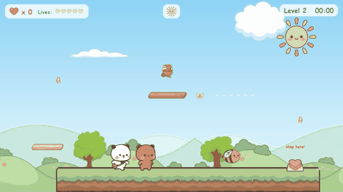
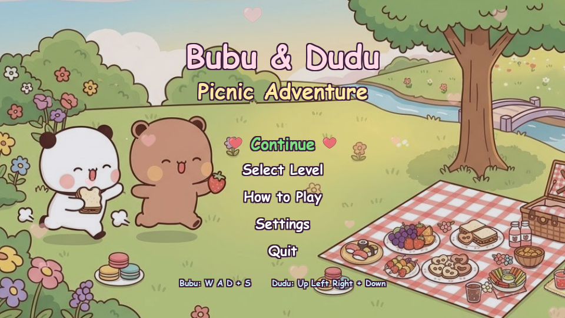
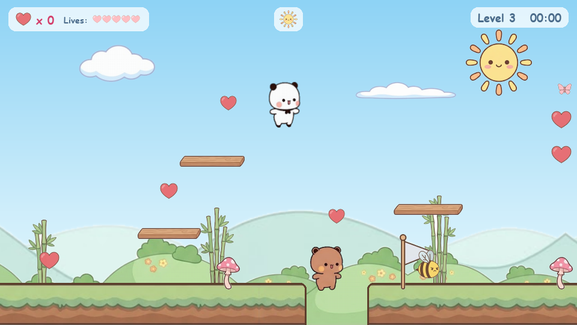
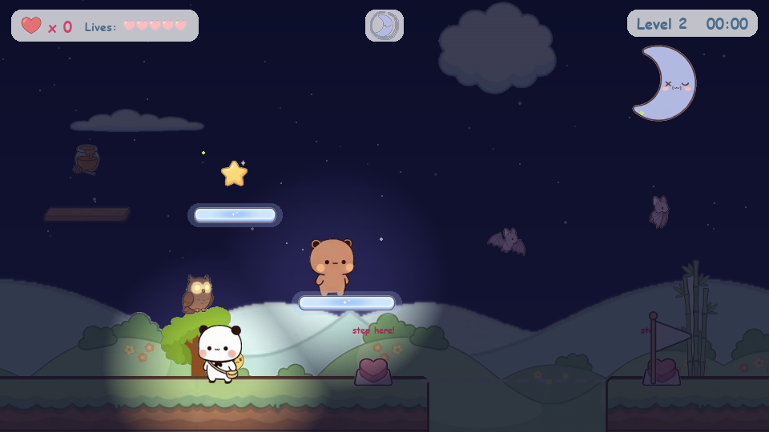
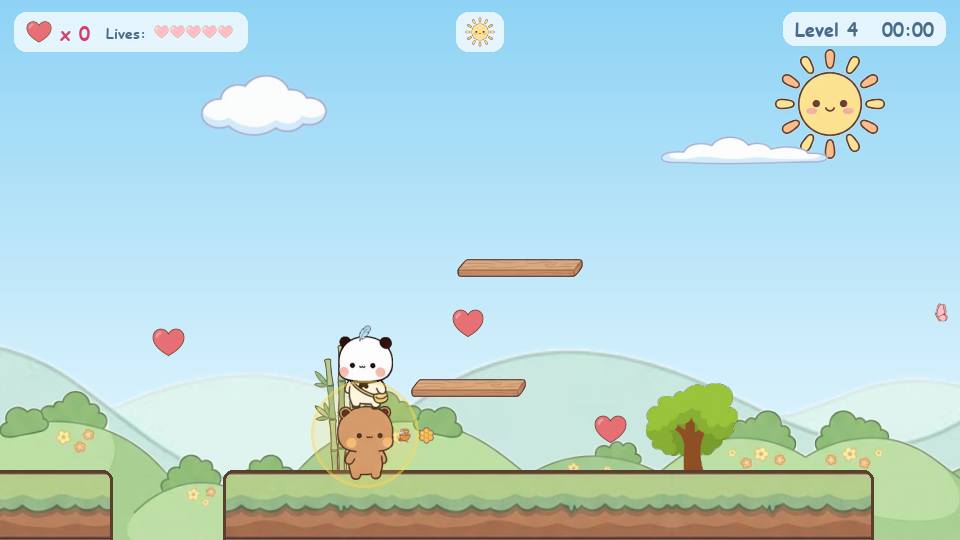
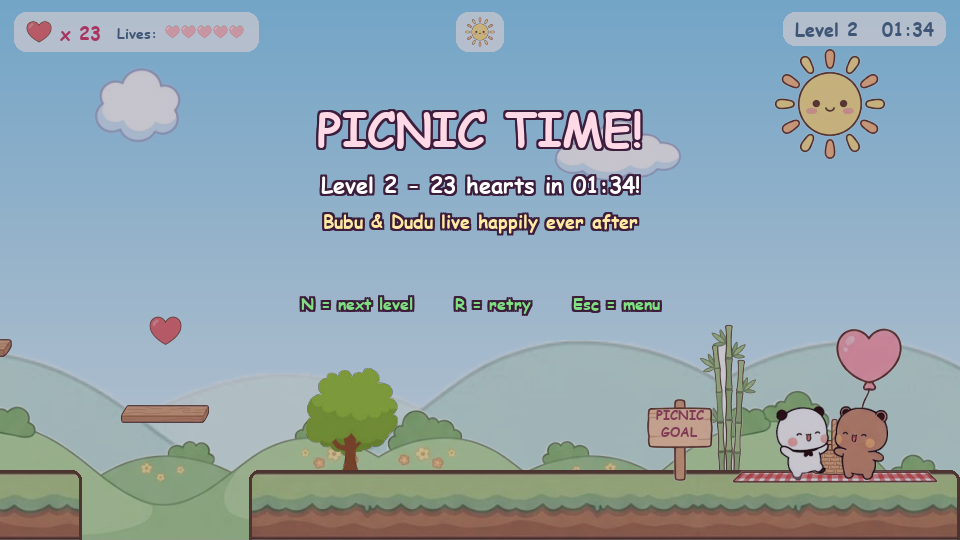
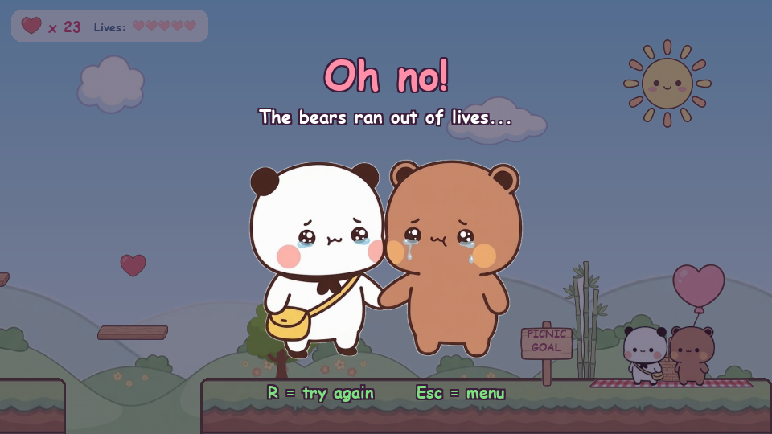

<p align="center">
  
</p>

<h1 align="center">Bubu & Dudu: Picnic Adventure</h1>

<p align="center">
  
  
  
  
  
  <a href="https://itch.io/jam/game-off-2026"></a>
</p>

> [!IMPORTANT]
> **Disclaimer.** This is an unofficial, non-commercial **fan project**. The Bubu & Dudu
> characters belong to their original creator; this project is not affiliated with or
> endorsed by them. The game is free and must not be sold.
> Most of the artwork was generated with AI image tools for this project.
> The **source code** is open source under the [MIT license](LICENSE);
> the **artwork in `assets/` is not covered by that license**.

A cozy two-player co-op platformer for one keyboard, written in Python with
[pygame](https://www.pygame.org/). Bubu and Dudu race through endless,
procedurally generated levels to reach their picnic blanket — together.

## 🏆 GitHub Game Off 2026

This game is an entry for [**GitHub Game Off 2026**](https://itch.io/jam/game-off-2026),
the month-long game jam whose theme this year is **SHIFT**.

**How it uses the theme:** the Shift key *is* the mechanic. Each player has their own
Shift (Left Shift for Bubu, Right Shift for Dudu), and pressing it shifts the whole
world between **day and night** — different enemies, different platforms, different
dangers. Because either player can trigger it, *when* to shift becomes a co-op decision.

**Made during the jam:** the base platformer existed before November; the day/night
SHIFT mechanic, the night enemies (bats and owls), moon platforms and stars, and the
new artwork were all built during Game Off.

<p align="center">
  
</p>

## 📸 Screenshots

<table>
  <tr>
    <td></td>
    <td></td>
  </tr>
  <tr>
    <td align="center">Main menu</td>
    <td align="center">Daytime: hearts, bees, bouncy mushrooms</td>
  </tr>
  <tr>
    <td></td>
    <td></td>
  </tr>
  <tr>
    <td align="center">Night: moon platforms, stars, owls and bats</td>
    <td align="center">Bear tower with power-ups</td>
  </tr>
  <tr>
    <td></td>
    <td></td>
  </tr>
  <tr>
    <td align="center">Picnic time!</td>
    <td align="center">Oh no…</td>
  </tr>
</table>

## ✨ Features

- 🐼🐻 **Local co-op** — two players on one keyboard; the camera keeps both bears on screen.
- 🌙 **Day / night with Shift** — either player can flip the world:
  - at night the bees fall asleep, but **bats** swoop and **owls** dive from the trees;
  - glowing **moon platforms** appear (only at night!) with **stars** worth 3 hearts;
  - it's dark — you only see what's near the bears.
- ♾️ **Endless levels** — every level is generated from a fixed seed, so level 7 is
  always the same level 7. Difficulty grows, and every 10th level is a **challenge**.
- 🤝 **Teamwork** — stand on your partner's head to build a bear tower; one bear holds
  down a heart plate so the bridge appears for the other.
- 🍯 **Power-ups** (12 s, they stack): honey (speed + jump), honeycomb shield,
  feather (double jump), magnet (pulls hearts), strawberry (grow big, squish bees).
- ❤️ 10 hearts = an extra life. Progress, settings and key bindings are saved.

## 🎮 Controls

| | Bubu 🐼 | Dudu 🐻 |
|---|---|---|
| Move | `A` `D` | `←` `→` |
| Jump | `W` | `↑` |
| Crouch | `S` | `↓` |
| Day / night | `Left Shift` | `Right Shift` |

`R` restart level · `N` next level · `Esc` menu.
All player keys can be changed in **Settings → Controls**.

## 🚀 Run from source

Requires Python 3.10+.

```bash
pip install -r requirements.txt
python main.py
```

## 📦 Build the Windows installer

```bash
pip install pyinstaller
python -m PyInstaller --noconfirm --clean --windowed --name BubuDudu --icon assets\icon.ico --add-data "assets;assets" main.py
```

Then compile [`installer.iss`](installer.iss) with [Inno Setup 6](https://jrsoftware.org/isinfo.php);
the result is `installer\BubuDudu-Setup.exe`.

## 🗂️ Project layout

| Path | What it is |
|---|---|
| `main.py` | The whole game: level generator, physics, enemies, drawing, menus |
| `assets/` | Sprites, icon and menu background used by the game |
| `import_items.py`, `import_sheets.py` | Cut new generated art sheets (`assets/_*_src.png`) into sprites — needs `pip install pillow numpy` |
| `installer.iss` | Inno Setup script for the Windows installer |
| `docs/screenshots/` | Images used in this README |

## 📄 License

The **code** is released under the [MIT license](LICENSE).
The **artwork** and the Bubu & Dudu characters are **not** — see the disclaimer above.
